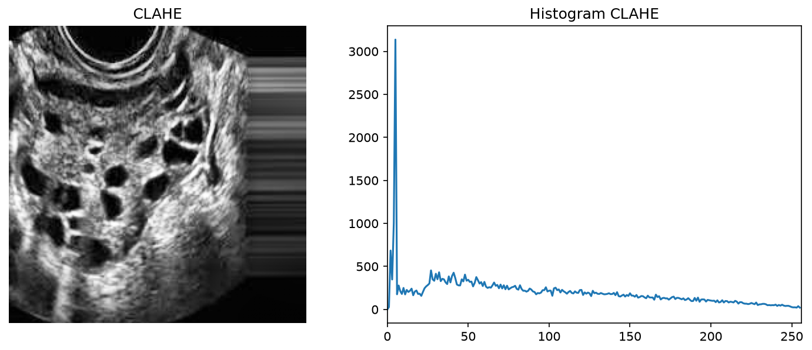

# 2. Contrast Limited Adaptive Histogram Equalization (CLAHE)

## Metode

CLAHE = HE lokal per tile (8×8) dengan batas clipping (clip 2.0) agar
kontras tidak over-amplify noise. Setiap tile di-equalize terpisah lalu
digabung dengan interpolasi — cocok untuk citra dengan terang tak merata
seperti USG.

## Code

`src/clahe.py` — murni Python-OpenCV:

```python
import cv2


def clahe(image, clip_limit=2.0, tile_grid_size=(8, 8)):
    clahe_obj = cv2.createCLAHE(clipLimit=clip_limit, tileGridSize=tile_grid_size)
    return clahe_obj.apply(image)


image = cv2.imread("dataset/infected/Image_003.jpg", cv2.IMREAD_GRAYSCALE)
cv2.imwrite("clahe.png", clahe(image, clip_limit=2.0))
```

## Hasil

Citra `Image_003.jpg` + histogram (`metrics.csv`: mean 59.01→88.18,
std 46.81→65.26, entropy 7.111→7.611):



## Analisis

- **Kelebihan:** entropy **tertinggi dari semua metode** (7.611 — detail
  lokal bertambah, bukan hilang); kontras naik tanpa washout; folikel dan
  tekstur jaringan tampak alami; konsisten terbaik di 3 citra.
- **Keterbatasan:** perlu pilih clip limit dan tile size; tile boundary
  bisa memunculkan artefak blok halus; peningkatan tidak sedramatis HE.
- **Objek terpisah?** Baik — folikel dan struktur jaringan paling jelas
  dibanding metode lain, sekaligus input paling bersih untuk segmentasi.
