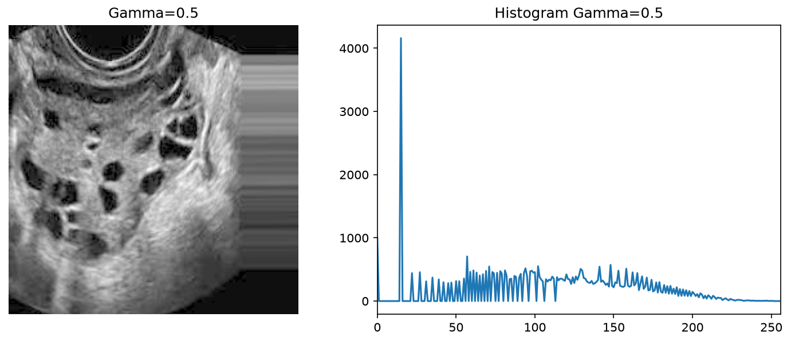

# 3. Gamma Correction

## Metode

Transformasi power-law `s = c·r^γ` pada intensitas ternormalisasi [0,1]:
γ<1 mencerahkan (mengangkat bayangan), γ>1 menggelapkan (menekan terang).
Diuji γ=0.5, 1.0 (identitas, kontrol), 2.0.

## Code

`src/gamma_correction.py`:

```python
import cv2
import numpy as np


def gamma_correction(image, gamma, c=1.0):
    normalized = image / 255.0
    corrected = c * np.power(normalized, gamma)
    return np.asarray(corrected * 255, dtype=np.uint8)


image = cv2.imread("dataset/infected/Image_003.jpg", cv2.IMREAD_GRAYSCALE)
cv2.imwrite("gamma_05.png", gamma_correction(image, 0.5))
```

## Hasil

Citra `Image_003.jpg`, varian γ=0.5 + histogram (`metrics.csv`: mean
59.01→109.24, std 46.81→54.72, entropy 7.111→6.953):



## Analisis

- **Kelebihan:** kontrol kecerahan paling intuitif; γ=0.5 memberi mean
  tertinggi (109.24) dengan entropy hampir terjaga (6.953); murah dan
  tanpa artefak spasial (transformasi titik, bukan filter).
- **Keterbatasan:** hanya menggeser kurva terang — tidak menambah kontras
  lokal; γ=2.0 merusak (mean 21.85, entropy anjlok ke 5.541, citra nyaris
  hitam, detail hilang); γ=1.0 sekadar identitas (kontrol validasi).
- **Objek terpisah?** Cukup — γ=0.5 membuat folikel/jaringan lebih mudah
  dilihat, tetapi separabilitasnya di bawah CLAHE karena tidak menambah
  informasi tepi/tekstur.
