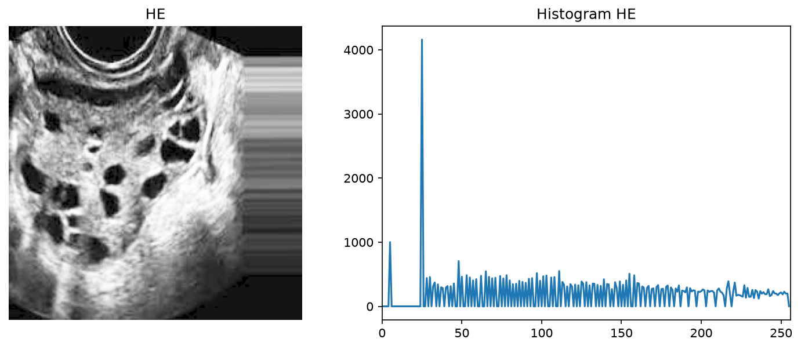

# 1. Histogram Equalization (HE)

## Metode

HE meratakan distribusi intensitas memakai CDF sebagai fungsi transformasi:
`s_k = (L−1)·Σ p(rⱼ)`. Tujuannya kontras global lebih merata — area gelap
diangkat, area terang ditekan.

## Code

`src/histogram_equalization.py`:

```python
import cv2
import numpy as np


def histogram_equalization(image):
    hist, _ = np.histogram(image.flatten(), 256, (0, 256))
    cdf = hist.cumsum()
    cdf_normalized = cdf * 255 / cdf.max()
    return cdf_normalized[image].astype(np.uint8)


image = cv2.imread("dataset/infected/Image_003.jpg", cv2.IMREAD_GRAYSCALE)
cv2.imwrite("he.png", histogram_equalization(image))
```

## Hasil

Citra `Image_003.jpg` + histogram (`metrics.csv`: mean 59.01→128.64,
std 46.81→72.18, entropy 7.111→6.934):



## Analisis

- **Kelebihan:** tanpa parameter; kontras global naik jelas (std +54%,
  citra jauh lebih terang, folikel dan jaringan mudah dibedakan).
- **Keterbatasan:** global — speckle/noise ikut diperkuat (histogram
  bergerigi, entropy justru turun 7.111→6.934); area terang berisiko
  washout; tidak adaptif terhadap perbedaan terang antar region.
- **Objek terpisah?** Cukup — visibilitas folikel membaik, tetapi noise
  yang terangkat membuat citra kasar untuk tahap segmentasi berikut.
