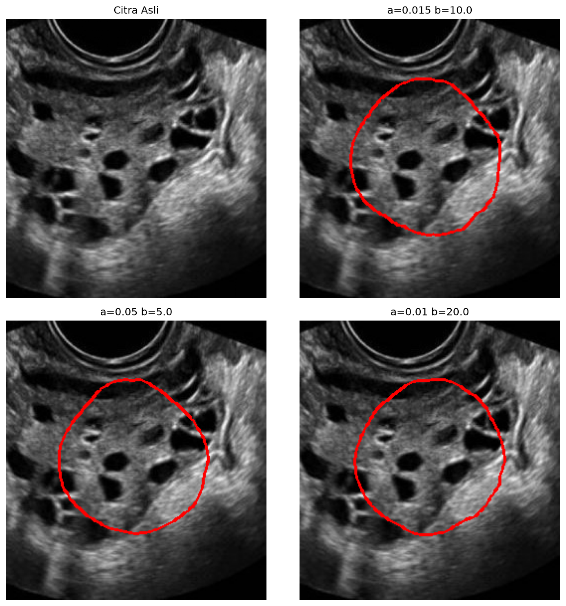

# 5. Active Contour (Snakes)

## Metode

Kontur lingkaran awal (200 titik, radius 30% sisi terpendek, di tengah
citra) dievolusikan meminimalkan `E = E_internal(α, β) + E_external`
via `skimage.segmentation.active_contour`. Diuji 3 set
`(α, β) = (0.015,10), (0.05,5), (0.01,20)`. Kontur akhir di-overlay merah.

## Code

`src/snakes.py`:

```python
import cv2
import numpy as np
from skimage.segmentation import active_contour


def snakes_segmentation(image, alpha=0.015, beta=10.0, gamma=0.001,
                        n_points=200, radius_ratio=0.3):
    h, w = image.shape
    cr, cc = h / 2, w / 2
    radius = min(h, w) * radius_ratio
    s = np.linspace(0, 2 * np.pi, n_points)
    init = np.stack([cr + radius * np.sin(s), cc + radius * np.cos(s)], axis=1)
    snake = active_contour(image.astype(np.float64) / 255.0, init,
                           alpha=alpha, beta=beta, gamma=gamma)
    return np.asarray(snake)
```

## Hasil



## Analisis

- **Kelebihan:** satu-satunya metode yang memberi **boundary halus dan
  tertutup** mengelilingi gugusan folikel (ROI ovarium) — bentuknya paling
  siap dipakai untuk pengukuran; ketiga varian konvergen ke area yang
  sama, artinya stabil terhadap pilihan (α, β) di citra ini.
- **Keterbatasan:** kontur tidak menempel presisi ke tepi folikel
  (boundary USG lemah + speckle, kontur berhenti di minimum lokal);
  inisialisasi lingkaran tengah bersifat asumsi — bila target di tepi,
  init harus diubah; komputasi paling mahal dari 5 metode.
- **Objek terpisah?** Ya untuk **ROI ovarium** sebagai lokalisasi kasar —
  lingkaran merah melingkupi area folikel dengan benar. Belum untuk
  folikel individual; untuk itu lanjutkan dengan K-Means `k=4` di dalam
  ROI ini (kombinasi metode, sesuai saran materi).
