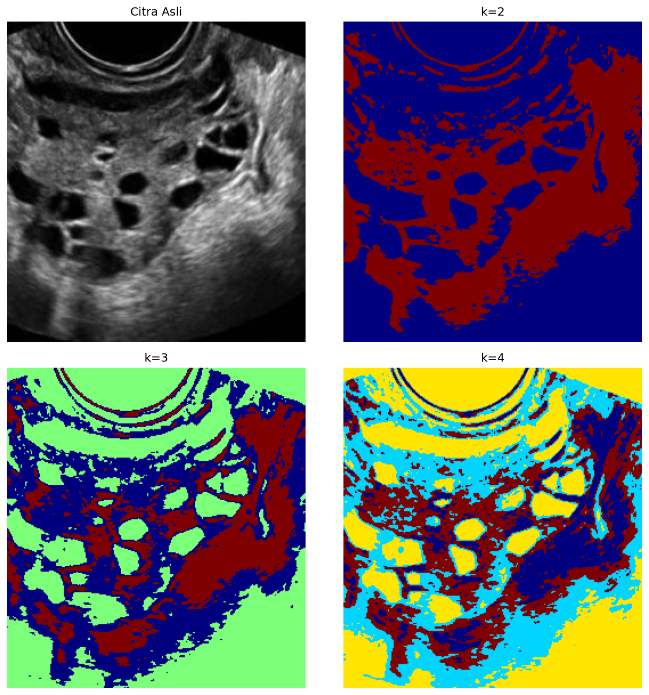

# 3. Clustering (K-Means)

## Metode

Tiap piksel dianggap data 1D (intensitas) lalu dikelompokkan ke `k` cluster
dengan meminimalkan `Σ‖x − μₖ‖²` (`cv2.kmeans`, init `KMEANS_PP_CENTERS`,
10 attempts). Diuji `k=2, 3, 4`. Catatan: K-Means tidak tahu anatomi —
warna cluster acak, artinya ("cluster mana = folikel?") ditentukan manual
dari hasil.

## Code

`src/clustering_kmeans.py`:

```python
import cv2
import numpy as np


def clustering_kmeans(image, k=2, attempts=10):
    samples = image.reshape((-1, 1)).astype(np.float32)
    criteria = (cv2.TERM_CRITERIA_EPS + cv2.TERM_CRITERIA_MAX_ITER, 10, 1.0)
    _, labels, _ = cv2.kmeans(
        samples, k, None, criteria, attempts, cv2.KMEANS_PP_CENTERS
    )
    labels = labels.reshape(image.shape).astype(np.uint8)
    return (labels * (255 // (k - 1))).astype(np.uint8)


image = cv2.imread("dataset/infected/image11690.jpg", cv2.IMREAD_GRAYSCALE)
cv2.imwrite("kmeans_k4.png", clustering_kmeans(image, k=4))
```

## Hasil



## Analisis

- **Kelebihan:** tanpa label/parameter ambang; `k=2` memberi peta
  jaringan-vs-gelap yang bersih; `k=4` memisahkan folikel sebagai cluster
  sendiri (kuning) — hasil terbaik di antara metode berbasis piksel untuk
  target folikel.
- **Keterbatasan:** `k` harus ditentukan manual dan hasilnya sensitif
  inisialisasi (diatasi dengan 10 attempts); cluster tidak punya makna
  anatomi bawaan; speckle membuat tepi cluster bergerigi.
- **Objek terpisah?** Paling baik untuk **folikel** pada `k=4` — gugusan
  folikel muncul sebagai blob kuning yang berkorespondensi dengan folikel
  di citra asli. Tinggal ambil satu label + bersihkan komponen kecil.
