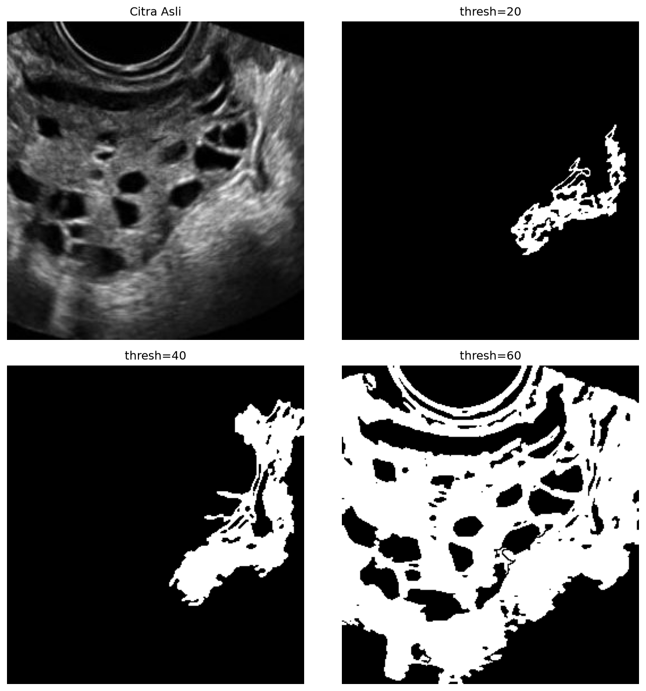

# 2. Region Growing

## Metode

Mulai dari satu **seed point**, lalu kembangkan region dengan menambahkan
piksel tetangga (8-connectivity, BFS) selama memenuhi
`|I(p) − mean(region)| ≤ thresh`. Seed dipilih otomatis: piksel
terterang **dan** terhomogen (skor `mean_lokal − std_lokal` box 15×15) di
ROI tengah — margin tepi 15% dan piksel jenuh (>250) dikecualikan agar tidak
jatuh di artefak bar/strip putih tepi citra USG.

## Code

`src/growing.py` — inti BFS (seed otomatis + Gaussian blur 5×5 di fungsi
`growing_segmentation`):

```python
from collections import deque

import cv2
import numpy as np


def growing_segmentation(image, seeds=None, thresh=40, blur_ksize=5):
    work = cv2.GaussianBlur(image, (blur_ksize, blur_ksize), 0)
    work = work.astype(np.float64)
    # seeds=None -> seed otomatis via skor intensitas-homogenitas
    ...
    visited = np.zeros(work.shape, dtype=bool)
    mask = np.zeros(work.shape, dtype=np.uint8)
    queue = deque([seed])
    region_sum, region_count = float(work[seed]), 1
    while queue:
        r, c = queue.popleft()
        if abs(float(work[r, c]) - region_sum / region_count) <= thresh:
            mask[r, c] = 255
            region_sum += float(work[r, c])
            region_count += 1
            for dr in (-1, 0, 1):
                for dc in (-1, 0, 1):
                    nr, nc = r + dr, c + dc
                    if 0 <= nr < h and 0 <= nc < w and not visited[nr, nc]:
                        visited[nr, nc] = True
                        queue.append((nr, nc))
    return mask
```

## Hasil



## Analisis

- **Kelebihan:** region dijamin terhubung (satu blob, bukan piksel
  tersebar); progresi thresh terbaca jelas — `t20` hanya fragmen kecil,
  `t40` sebagian jaringan, `t60` hampir seluruh jaringan dengan lubang
  folikel yang rapi.
- **Keterbatasan:** sangat sensitif pada seed dan thresh. Seed `argmax`
  naif jatuh di artefak tepi dan menghasilkan mask kosong (pernah terjadi
  di `Image_001`/`Image_005` sebelum seed diperbaiki); `t60` mulai bocor
  ke area non-jaringan.
- **Objek terpisah?** Ya untuk **jaringan** (t60), belum untuk folikel
  sebagai objek sendiri — folikel justru menjadi lubang di dalam region.
  Cocok bila targetnya area jaringan, bukan folikel individual.
