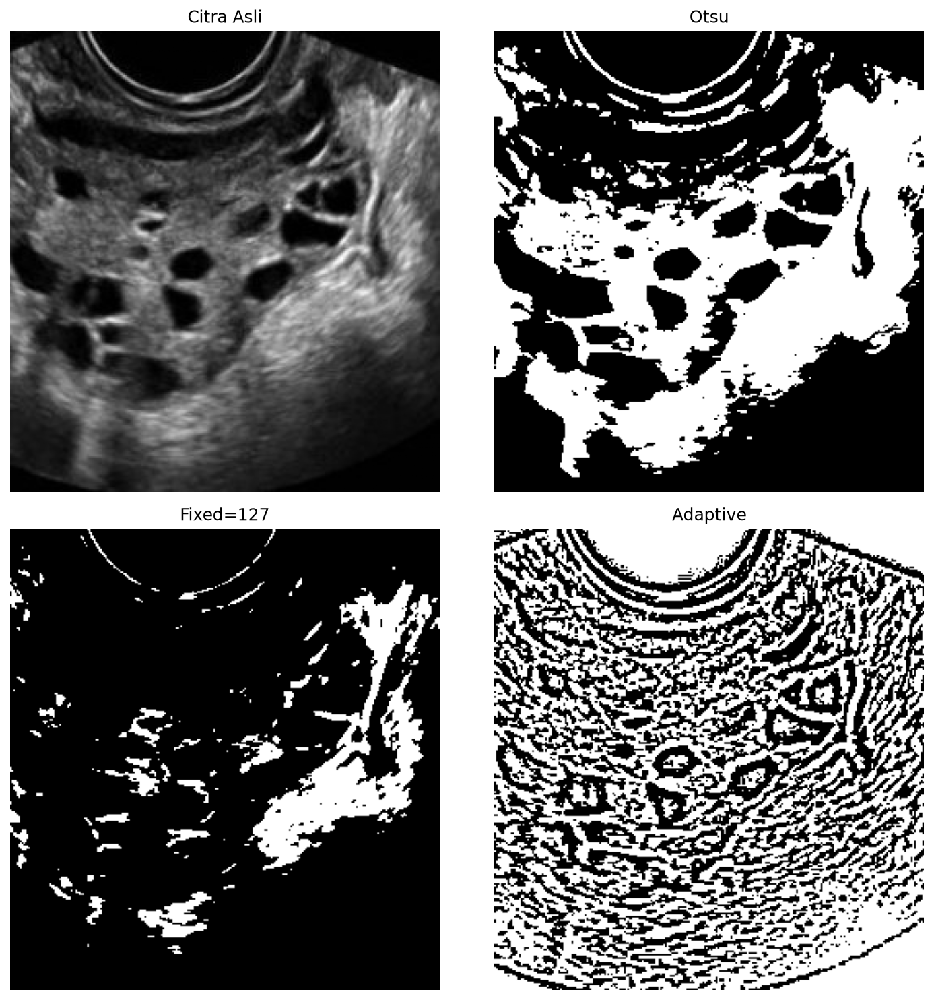

# 1. Thresholding

## Metode

Thresholding memisahkan objek dan background hanya dari nilai intensitas:
piksel ≥ T jadi foreground (putih), di bawahnya jadi background (hitam).
Tiga varian diuji: **Otsu** (T otomatis pemaksim variansi antar-kelas),
**fixed T=127**, dan **adaptive-Gaussian** (T lokal per blok 11×11).

## Code

`src/thresholding.py` — murni Python-OpenCV:

```python
import cv2
import numpy as np


def thresholding(image, method="otsu", thresh_value=127, block_size=11, c=2):
    if method == "otsu":
        _, result = cv2.threshold(image, 0, 255, cv2.THRESH_BINARY + cv2.THRESH_OTSU)
    elif method == "fixed":
        _, result = cv2.threshold(image, thresh_value, 255, cv2.THRESH_BINARY)
    elif method == "adaptive":
        result = cv2.adaptiveThreshold(
            image, 255, cv2.ADAPTIVE_THRESH_GAUSSIAN_C,
            cv2.THRESH_BINARY, block_size, c,
        )
    return result


image = cv2.imread("dataset/infected/image11690.jpg", cv2.IMREAD_GRAYSCALE)
cv2.imwrite("otsu.png", thresholding(image, "otsu"))
```

## Hasil

Citra `image11690.jpg` (folikel hipoekoik gelap di tengah jaringan terang):



## Analisis

- **Kelebihan:** tercepat dan paling sederhana; Otsu tanpa parameter dan
  langsung memisahkan jaringan terang (putih) dari folikel/background
  (hitam) — folikel terlihat sebagai blob hitam yang cukup jelas.
- **Keterbatasan:** piksel se-intensitas dianggap sama tanpa melihat posisi,
  sehingga mask putih ikut mencakup area non-target; `fixed=127` terlalu
  gelap (banyak jaringan hilang); `adaptive` justru ber-noise parah karena
  speckle USG ikut terangkat per blok.
- **Objek terpisah?** Sebagian — folikel terbedakan sebagai lubang hitam di
  mask Otsu, tetapi tidak ada satu mask yang mengisolasi "ovarium/folikel"
  sebagai objek tunggal. Perlu post-processing (mis. pilih komponen terbesar).
