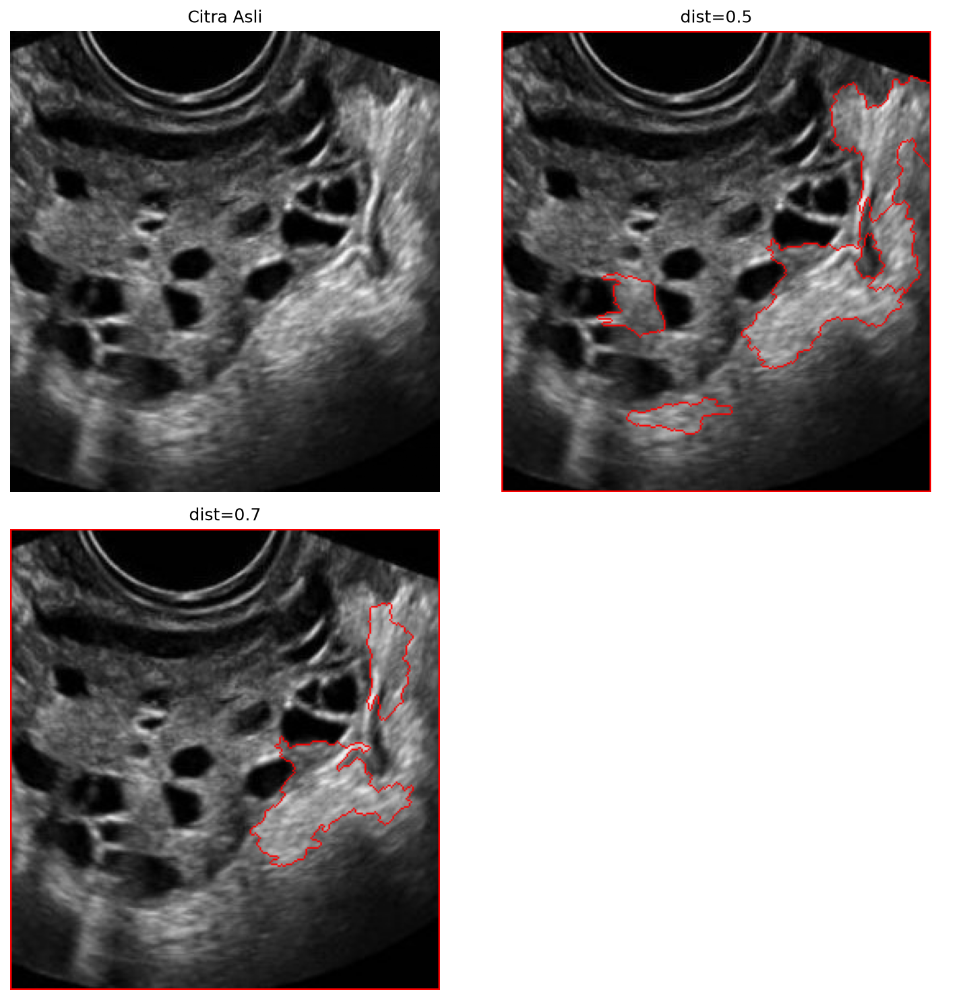

# 4. Watershed

## Metode

Citra diperlakukan sebagai topografi: Otsu → opening → `dilate` (sure
background) → `distanceTransform` (sure foreground via `dist_ratio`) →
`connectedComponents` sebagai marker → `cv2.watershed`. Batas antar region
(marker `-1`) di-overlay merah. Diuji `dist_ratio=0.5` dan `0.7`.

## Code

`src/watershed.py` — inti pipeline marker:

```python
import cv2
import numpy as np


def watershed_segmentation(image, dist_ratio=0.7, kernel_size=3):
    _, binary = cv2.threshold(image, 0, 255, cv2.THRESH_BINARY + cv2.THRESH_OTSU)
    kernel = np.ones((kernel_size, kernel_size), np.uint8)
    opening = cv2.morphologyEx(binary, cv2.MORPH_OPEN, kernel, iterations=2)

    sure_bg = cv2.dilate(opening, kernel, iterations=3)
    dist = cv2.distanceTransform(opening, cv2.DIST_L2, 5)
    _, sure_fg = cv2.threshold(dist, dist_ratio * dist.max(), 255, cv2.THRESH_BINARY)
    unknown = cv2.subtract(sure_bg, sure_fg.astype(np.uint8))

    _, markers = cv2.connectedComponents(sure_fg.astype(np.uint8))
    markers = markers + 1
    markers[unknown == 255] = 0
    return cv2.watershed(cv2.cvtColor(image, cv2.COLOR_GRAY2BGR), markers)
```

## Hasil



## Analisis

- **Kelebihan:** garis batas mengikuti kontur struktur jaringan/folikel
  (terlihat di area kanan); `dist=0.7` lebih sedikit region dibanding
  `dist=0.5`; marker-based sehingga over-segmentation terkendali (tidak
  meledak jadi ratusan region seperti watershed klasik di USG).
- **Keterbatasan:** tetap menghasilkan beberapa region, bukan satu objek;
  bingkai tepi citra ikut terdeteksi sebagai batas (frame merah keliling
  — artefak batas citra, bukan anatomi); sensitivitas marker terhadap
  speckle masih terlihat dari region kecil di tengah.
- **Objek terpisah?** Sebagian — batas region valid secara lokal, tetapi
  folikel/ovarium belum terisolasi sebagai satu region. Paling berguna
  sebagai tahap pemisah area bersentuhan, bukan segmentasi final.
