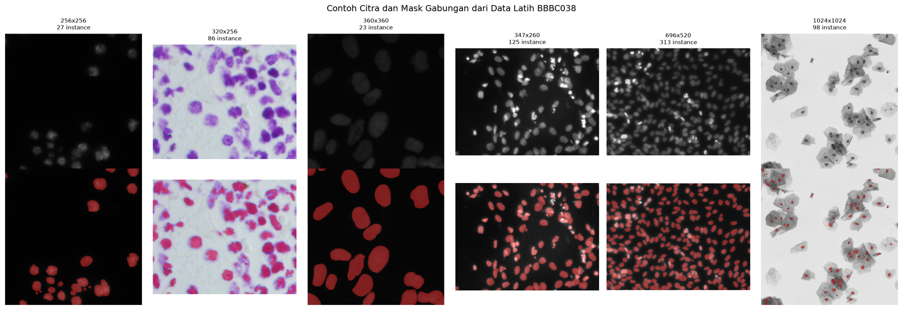
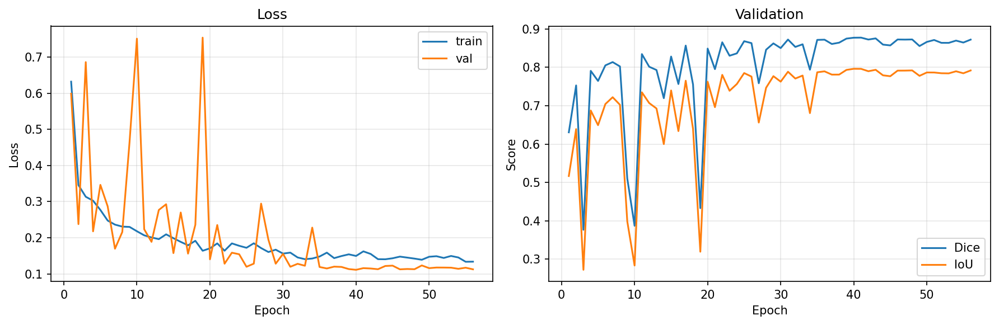
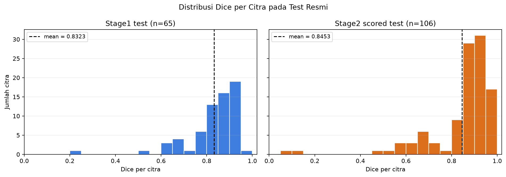
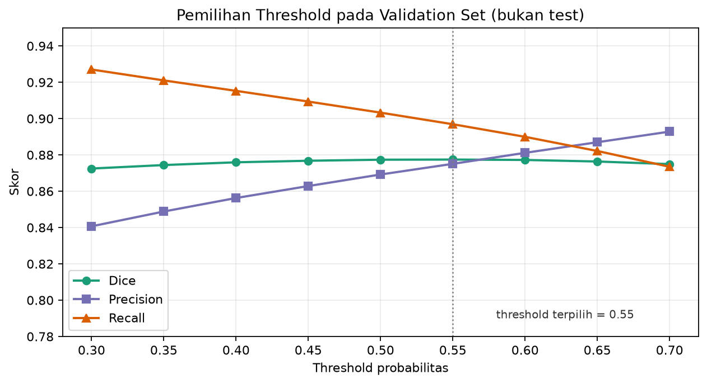
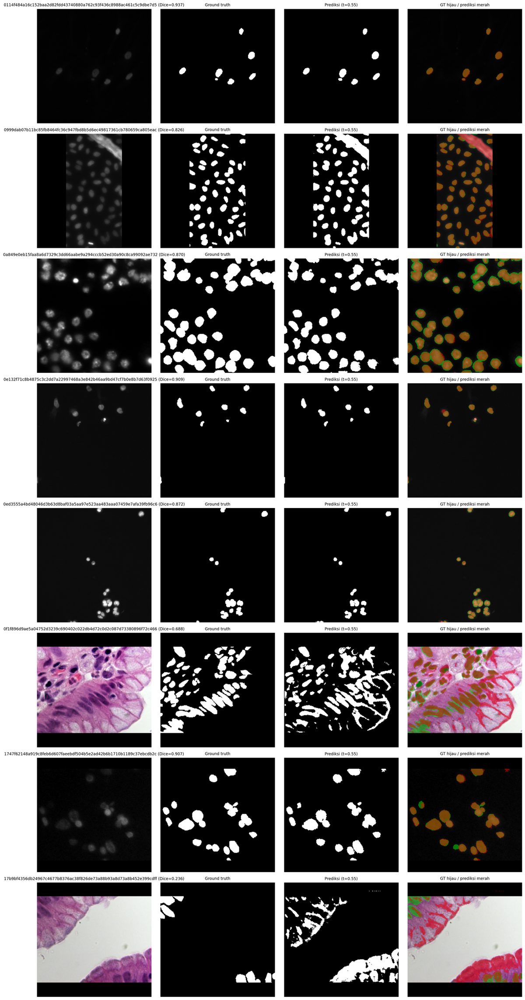
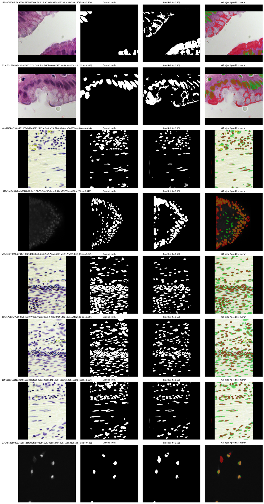
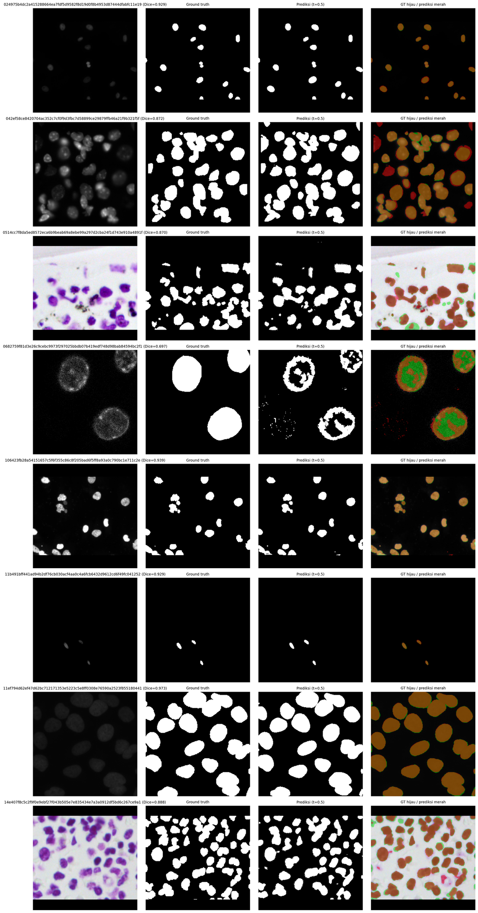
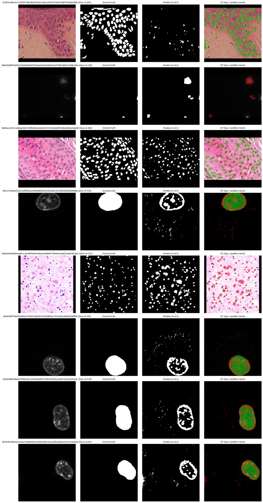

# BAB II – PEMBAHASAN

Bab ini membahas dasar teori yang digunakan, karakteristik dataset BBBC038, detail implementasi sistem segmentasi nukleus berbasis U-Net, serta hasil eksperimen yang benar-benar dijalankan pada proyek ini. Seluruh nilai metrik, kurva, dan gambar prediksi pada Subbab 2.4 diambil dari hasil eksperimen `experiments/baseline`, bukan nilai ilustratif.

---

## 2.1 Teori Singkat

### 2.1.1 Segmentasi Citra

Segmentasi citra adalah proses membagi citra menjadi daerah-daerah yang bermakna, misalnya dengan memisahkan objek (foreground) dari latar belakang (background). Pada citra medis, segmentasi digunakan untuk mengisolasi struktur tertentu seperti sel, nukleus, organ, atau jaringan abnormal.

Berdasarkan granularitasnya, segmentasi dapat dibedakan menjadi:

- **Segmentasi semantik (semantic segmentation):** setiap piksel diberi label kelas. Semua nukleus pada proyek ini diberi satu kelas yang sama, yaitu _foreground_.
- **Segmentasi instance:** setiap objek individual diberi identitas tersendiri, sehingga dua nukleus yang bersentuhan tetap dianggap dua objek berbeda.
- **Segmentasi panoptik:** gabungan segmentasi semantik dan instance.

Proyek ini menggunakan **segmentasi semantik biner**. Seluruh mask instance pada data latih digabung menjadi satu mask biner: nilai 1 untuk piksel nukleus dan 0 untuk latar belakang. Model menghasilkan satu peta probabilitas per piksel, lalu ambang batas (_threshold_) tertentu mengubahnya menjadi mask biner.

Secara formal, untuk citra masukan $X$ berukuran $H \times W \times C$, model $f_\theta$ memetakan setiap piksel ke probabilitas:

$$
\hat{Y} = f_\theta(X), \qquad \hat{Y}_{ij} \in [0,1]
$$

Mask biner diperoleh dengan:

$$
M_{ij} =
\begin{cases}
1, & \hat{Y}_{ij} \geq t \\
0, & \hat{Y}_{ij} < t
\end{cases}
$$

dengan $t$ adalah threshold yang dipilih pada validation set.

### 2.1.2 Arsitektur U-Net

U-Net diperkenalkan oleh Ronneberger, Fischer, dan Brox (2015) [1] untuk segmentasi citra biomedis dengan data latih yang relatif sedikit. Arsitekturnya berbentuk huruf U dan terdiri atas dua bagian:

1. **Encoder (contracting path):** serangkaian blok konvolusi dan _max pooling_ yang mengecilkan resolusi spasial sekaligus mengekstraksi fitur dari tingkat kasar hingga abstrak.
2. **Decoder (expanding path):** serangkaian _upsampling_ dan konvolusi yang mengembalikan resolusi spasial untuk menghasilkan prediksi per piksel.

Kunci U-Net adalah **skip connection**. Fitur dari encoder pada resolusi tertentu digabungkan (_concatenate_) dengan fitur decoder pada resolusi yang sama. Jalur ini membantu decoder memulihkan detail spasial yang hilang akibat pooling, sehingga batas objek dapat diprediksi lebih presisi.

Setiap blok konvolusi pada implementasi ini terdiri atas:

$$
\text{Conv}_{3\times3} \rightarrow \text{BatchNorm} \rightarrow \text{ReLU} \rightarrow \text{Conv}_{3\times3} \rightarrow \text{BatchNorm} \rightarrow \text{ReLU}
$$

Pada encoder, setiap tahap diikuti _max pooling_ $2\times2$. Pada decoder, resolusi dinaikkan dengan _transposed convolution_ $2\times2$, lalu hasilnya digabung dengan skip connection dan diproses oleh blok konvolusi ganda. Lapisan terakhir adalah konvolusi $1\times1$ yang menghasilkan satu kanal logit.

Keunggulan U-Net untuk segmentasi nukleus adalah kemampuannya menangkap konteks luas melalui encoder sekaligus mempertahankan detail batas objek melalui skip connection. Hal ini penting karena nukleus dapat berukuran kecil, berdekatan, dan memiliki batas yang samar.

### 2.1.3 Metrik Evaluasi: Dice, IoU, Precision, dan Recall

Karena segmentasi biner dapat dipandang sebagai klasifikasi per piksel, evaluasi dihitung dari empat besaran dasar:

- **True Positive (TP):** piksel nukleus yang diprediksi nukleus.
- **False Positive (FP):** piksel latar yang diprediksi nukleus.
- **False Negative (FN):** piksel nukleus yang diprediksi latar.
- **True Negative (TN):** piksel latar yang diprediksi latar.

**Dice coefficient** [2] mengukur tumpang tindih antara prediksi $P$ dan ground truth $G$:

$$
\text{Dice}(P,G) = \frac{2|P \cap G|}{|P| + |G|}
= \frac{2\,\text{TP}}{2\,\text{TP} + \text{FP} + \text{FN}}
$$

Nilai Dice berkisar dari 0 (tidak ada tumpang tindih) hingga 1 (prediksi identik dengan ground truth).

**Intersection over Union (IoU)** [3], atau _Jaccard index_, mengukur rasio irisan terhadap gabungan:

$$
\text{IoU}(P,G) = \frac{|P \cap G|}{|P \cup G|}
= \frac{\text{TP}}{\text{TP} + \text{FP} + \text{FN}}
$$

IoU dan Dice saling berhubungan secara monoton:

$$
\text{IoU} = \frac{\text{Dice}}{2 - \text{Dice}}
$$

Karena itu IoU selalu lebih kecil atau sama dengan Dice untuk mask yang sama.

**Precision** mengukur seberapa banyak prediksi positif yang benar:

$$
\text{Precision} = \frac{\text{TP}}{\text{TP} + \text{FP}}
$$

**Recall** (sensitivitas) mengukur seberapa banyak piksel nukleus yang berhasil ditemukan:

$$
\text{Recall} = \frac{\text{TP}}{\text{TP} + \text{FN}}
$$

Precision yang tinggi menunjukkan model jarang menghasilkan region palsu, sedangkan recall yang tinggi menunjukkan model jarang melewatkan nukleus. Keduanya penting karena dalam segmentasi medis, _false negative_ berarti nukleus hilang dan _false positive_ berarti muncul region yang sebenarnya bukan nukleus.

Pada proyek ini, seluruh metrik dihitung **per citra**, kemudian dilaporkan sebagai rata-rata ± standar deviasi. Pendekatan ini lebih informatif daripada menggabungkan semua piksel, karena citra dengan nukleus sangat sedikit tidak akan tenggelam oleh citra dengan nukleus sangat banyak.

---

## 2.2 Dataset BBBC038

### 2.2.1 Gambaran Umum

BBBC038 adalah dataset nukleus yang dipublikasikan oleh Broad Bioimage Benchmark Collection (BBBC) [4,5] dan digunakan pada kompetisi _2018 Data Science Bowl_. Dataset ini berisi citra mikroskop dari berbagai organisme, jenis jaringan, pewarnaan, dan modalitas pencitraan. Variasi tersebut membuat dataset ini menantang: model harus mampu menangani perbedaan kontras, ukuran nukleus, kepadatan sel, serta kualitas citra.

Pada proyek ini, dataset dibagi menjadi beberapa bagian:

| Bagian              | Jumlah citra | Peran                                                                  |
| ------------------- | -----------: | ---------------------------------------------------------------------- |
| `stage1_train`      |          670 | Data latih dan validasi                                                |
| `stage1_test`       |           65 | Test resmi stage1 (`Public`)                                           |
| `stage2_test_final` |        3.019 | Prediksi eksternal; hanya 106 citra berlabel `Private` yang dievaluasi |
| **Total**           |    **3.754** |                                                                        |

Dari 670 citra latih, dihasilkan **29.461 mask instance**. Seluruh mask instance tersebut digabung menjadi satu mask biner per citra, sehingga terdapat 670 pasangan citra–mask biner yang kemudian dibagi menjadi 570 citra latih dan 100 citra validasi.

Ground truth test resmi tidak disediakan sebagai file mask, melainkan dalam bentuk **Run-Length Encoding (RLE)** pada:

- `data/solutions/stage1_solution.csv`
- `data/solutions/stage2_solution_final.csv`

Script `prepare_test.py` men-decode RLE tersebut menjadi mask biner. Pada stage2, hanya citra dengan `Usage = Private` yang dipakai untuk metrik. Sebanyak 2.913 citra berstatus `Ignored` memiliki mask dummy berukuran $10 \times 10$, sehingga tidak boleh dievaluasi.

### 2.2.2 Statistik Data

Statistik berikut dihitung langsung dari laporan dataset `data/processed/dataset_report.json` yang dihasilkan `prepare_data.py` pada 670 citra latih.

**Distribusi ukuran citra:**

| Ukuran (lebar × tinggi) | Jumlah citra |
| ----------------------- | -----------: |
| 256 × 256               |          334 |
| 320 × 256               |          112 |
| 696 × 520               |           92 |
| 360 × 360               |           91 |
| 1024 × 1024             |           16 |
| 640 × 512               |           13 |
| 1.272 × 603             |            6 |
| 347 × 260               |            5 |
| 1.388 × 1.040           |            1 |

Ukuran citra sangat bervariasi, dari 256 × 256 hingga 1.388 × 1.040 piksel. Karena itu, seluruh citra di-resize dengan mempertahankan aspek rasio dan di-pad hingga berbentuk persegi $256 \times 256$.

**Distribusi jumlah instance dan area foreground:**

| Statistik                      |           Nilai |
| ------------------------------ | --------------: |
| Jumlah instance total          |          29.461 |
| Instance per citra — minimum   |               1 |
| Instance per citra — maksimum  |             375 |
| Instance per citra — rata-rata |           43,97 |
| Foreground ratio — minimum     | 0,00029 (0,03%) |
| Foreground ratio — median      | 0,1067 (10,67%) |
| Foreground ratio — rata-rata   | 0,1392 (13,92%) |
| Foreground ratio — maksimum    | 0,5920 (59,20%) |

Foreground ratio adalah proporsi piksel nukleus terhadap seluruh piksel citra. Nilainya sangat bervariasi: ada citra dengan foreground sangat sedikit (0,03% area), ada pula citra dengan nukleus sangat padat hingga hampir 60% area. Ketidakseimbangan ini membuat segmentasi nukleus bukan masalah yang sepele.



_Gambar 2.1 — Enam contoh citra latih dengan variasi ukuran, kepadatan, dan modalitas. Baris atas: citra asli; baris bawah: mask gabungan (seluruh instance digabung menjadi satu region merah)._

### 2.2.3 Tantangan Data

Berdasarkan statistik dan pengamatan visual, tantangan utama dataset ini adalah:

1. **Variasi ukuran dan resolusi.** Citra berasal dari perbesaran berbeda, sehingga ukuran nukleus dalam piksel sangat beragam.
2. **Kepadatan tinggi.** Satu citra dapat memuat hingga 375 nukleus. Nukleus yang bersentuhan atau bertumpuk sulit dipisahkan, terutama pada segmentasi semantik yang tidak membedakan instance.
3. **Kontras dan pewarnaan beragam.** Sebagian citra adalah fluoresensi dengan latar gelap, sebagian lagi brightfield dengan latar terang.
4. **Batas samar.** Beberapa nukleus memiliki tepi yang tidak tajam atau menyatu dengan jaringan di sekitarnya.
5. **Ketidakseimbangan kelas ekstrem.** Pada citra dengan foreground paling sedikit, foreground ratio hanya 0,03%, sehingga loss berbasis piksel dapat didominasi oleh latar belakang.
6. **Label test terbatas.** Dari 3.019 citra stage2, hanya 106 yang memiliki ground truth untuk evaluasi; sisanya tidak dapat dipakai mengukur performa.

---

## 2.3 Implementasi

### 2.3.1 Ringkasan Pipeline

Sistem diimplementasikan sebagai proyek Python modular dengan alur:

```text
data mentah
   │
   ├── prepare_data.py  → gabung mask instance, validasi, split train/val
   ├── prepare_test.py  → decode RLE ground truth test resmi
   │
   ├── train.py         → training + validasi + checkpoint + history
   ├── evaluate.py      → metrik test, threshold tuning, visualisasi
   └── predict.py       → prediksi mask untuk citra tanpa ground truth
```

Struktur kode utama:

```text
unet-nuclei-segmentation/
├── configs/config.yaml
├── src/
│   ├── data/          # preprocessing, augmentasi, dataset, manifest, RLE, split
│   ├── models/        # U-Net dan blok penyusun
│   ├── training/      # loss, optimizer, trainer
│   ├── evaluation/    # metrik dan evaluator
│   └── utils/         # config, checkpoint, logger, visualisasi
├── scripts/           # prepare_data, prepare_test, train, evaluate, predict
└── experiments/       # config, history, metrik, checkpoint, visualisasi
```

Potongan konfigurasi eksperimen baseline (hanya nilai utama yang relevan; kunci `project`, `paths`, `pin_memory`, `normalize_*`, dan `evaluation` tidak ditampilkan):

```yaml
data:
  image_size: 256
  val_ratio: 0.15
  num_workers: 2

model:
  architecture: unet
  in_channels: 3
  out_channels: 1
  base_channels: 64
  depth: 4
  bilinear: false
  dropout: 0.0

training:
  epochs: 100
  batch_size: 16
  learning_rate: 0.0005
  weight_decay: 0.0001
  amp: true
  grad_clip: 1.0
  scheduler: plateau
  scheduler_factor: 0.5
  scheduler_patience: 4
  early_stopping_patience: 15
  min_delta: 0.0001
  threshold: 0.5

loss:
  bce_weight: 0.5
  dice_weight: 0.5
  bce_pos_weight: 1.0
```

### 2.3.2 Preprocessing

Preprocessing bertujuan menyamakan format citra dan menyiapkan mask biner.

**a. Konversi citra ke RGB uint8.** Citra BBBC038 dapat berupa grayscale, RGB, RGBA, maupun 16-bit. Semua citra dikonversi menjadi RGB 8-bit. Untuk citra 16-bit, digunakan normalisasi persentil 1–99 agar outlier intensitas tidak mendominasi:

```python
def _to_uint8(image: np.ndarray) -> np.ndarray:
    arr = image.astype(np.float32)
    low, high = float(arr.min()), float(arr.max())
    if high <= low:
        return np.zeros_like(arr, dtype=np.uint8)
    return np.clip((arr - low) / (high - low) * 255.0, 0, 255).astype(np.uint8)


def _uint16_to_uint8(image: np.ndarray) -> np.ndarray:
    low, high = np.percentile(image, (1, 99))
    if high <= low:
        low, high = float(image.min()), float(image.max())
    if high <= low:
        return np.zeros_like(image, dtype=np.uint8)
    scaled = (image.astype(np.float32) - low) / (high - low) * 255.0
    return np.clip(scaled, 0, 255).astype(np.uint8)


def load_image_rgb(path: str | Path) -> np.ndarray:
    """Baca citra apa pun menjadi RGB uint8 (alpha dibuang)."""
    image_path = Path(path)
    image = cv2.imread(str(image_path), cv2.IMREAD_UNCHANGED)
    if image is None:
        raise FileNotFoundError(f"Gagal membaca citra: {image_path}")

    if image.ndim == 2:
        image = np.repeat(image[:, :, None], 3, axis=2)
    elif image.ndim == 3:
        channels = image.shape[2]
        if channels == 1:
            image = np.repeat(image, 3, axis=2)
        elif channels == 2:
            image = np.repeat(image[:, :, :1], 3, axis=2)
        elif channels >= 4:
            image = image[:, :, :3]
    else:
        raise ValueError(f"Shape citra tidak didukung: {image.shape}")

    if image.dtype == np.uint16:
        image = _uint16_to_uint8(image)
    elif image.dtype != np.uint8:
        image = _to_uint8(image)

    return cv2.cvtColor(image, cv2.COLOR_BGR2RGB)
```

**b. Penggabungan mask instance.** Setiap folder citra latih memiliki banyak mask instance. Seluruh mask digabung dengan operasi OR logika, lalu disimpan sebagai citra 0/255:

```python
def merge_instance_masks(
    mask_paths: Iterable[str | Path],
    shape: Sequence[int] | None = None,
) -> np.ndarray:
    masks: list[np.ndarray] = []
    expected = tuple(shape) if shape is not None else None

    for mask_path in mask_paths:
        mask = cv2.imread(str(mask_path), cv2.IMREAD_GRAYSCALE)
        if mask is None:
            raise FileNotFoundError(f"Gagal membaca mask: {mask_path}")
        if expected is None:
            expected = mask.shape
        if mask.shape != expected:
            raise ValueError(f"Ukuran mask {mask_path} {mask.shape} != {expected}")
        masks.append(mask > 0)

    if not masks:
        raise ValueError("Daftar mask instance kosong")

    merged = np.logical_or.reduce(masks).astype(np.uint8) * 255
    return merged
```

Dengan cara ini, informasi instance hilang dan tersisa satu kelas foreground. Ini adalah konsekuensi langsung dari pilihan tugas **binary semantic segmentation**.

**c. Resize, padding, dan normalisasi.** Semua citra di-resize agar sisi terpanjangnya menjadi 256 piksel dengan interpolasi `INTER_AREA`. Mask menggunakan interpolasi `INTER_NEAREST` agar nilai biner tidak rusak. Setelah itu, citra di-pad menjadi $256 \times 256$ dan dinormalisasi dengan mean dan standar deviasi 0,5 pada setiap kanal:

$$
x_{\text{norm}} = \frac{x/255 - 0{,}5}{0{,}5}
$$

### 2.3.3 Augmentasi

Augmentasi hanya diterapkan pada data latih. Tujuannya meningkatkan variasi data tanpa mengubah label secara semantik. Pipeline training menggunakan Albumentations:

```python
def build_train_transforms(
    image_size: int,
    mean: tuple[float, float, float] = (0.5, 0.5, 0.5),
    std: tuple[float, float, float] = (0.5, 0.5, 0.5),
) -> Compose:
    """Transformasi training: jaga aspek rasio, pad ke persegi, augmentasi."""
    return Compose(
        [
            LongestMaxSize(
                max_size=image_size,
                interpolation=cv2.INTER_AREA,
                mask_interpolation=cv2.INTER_NEAREST,
            ),
            PadIfNeeded(
                min_height=image_size,
                min_width=image_size,
                border_mode=cv2.BORDER_CONSTANT,
                fill=0,
                fill_mask=0,
            ),
            HorizontalFlip(p=0.5),
            VerticalFlip(p=0.5),
            RandomRotate90(p=0.5),
            Affine(
                scale=(0.9, 1.1),
                translate_percent=(-0.05, 0.05),
                rotate=(-15, 15),
                border_mode=cv2.BORDER_CONSTANT,
                fill=0,
                fill_mask=0,
                p=0.5,
            ),
            RandomBrightnessContrast(
                brightness_limit=0.15,
                contrast_limit=0.15,
                p=0.3,
            ),
            GaussNoise(p=0.2),
            GaussianBlur(blur_limit=(3, 5), p=0.1),
            Normalize(mean=mean, std=std, max_pixel_value=255.0),
            ToTensorV2(),
        ]
    )
```

Pipeline evaluasi tidak menggunakan flip, rotasi, noise, atau perubahan kontras; hanya resize, padding, normalisasi, dan konversi ke tensor. Dengan demikian, evaluasi bersifat deterministik.

### 2.3.4 Arsitektur U-Net

Model yang digunakan adalah U-Net dengan `base_channels = 64` dan `depth = 4`. Jumlah kanal encoder adalah 64, 128, 256, 512, dan 1.024. Total parameter yang dapat dilatih adalah **31.037.633**.

**Blok konvolusi ganda:**

```python
class DoubleConv(nn.Module):
    """(Conv3x3 -> BN -> ReLU) x 2."""

    def __init__(
        self,
        in_channels: int,
        out_channels: int,
        mid_channels: int | None = None,
        dropout: float = 0.0,
    ) -> None:
        super().__init__()
        hidden = mid_channels or out_channels
        layers: list[nn.Module] = [
            nn.Conv2d(in_channels, hidden, kernel_size=3, padding=1, bias=False),
            nn.BatchNorm2d(hidden),
            nn.ReLU(inplace=True),
            nn.Conv2d(hidden, out_channels, kernel_size=3, padding=1, bias=False),
            nn.BatchNorm2d(out_channels),
            nn.ReLU(inplace=True),
        ]
        if dropout > 0:
            layers.append(nn.Dropout2d(p=dropout))
        self.block = nn.Sequential(*layers)

    def forward(self, x: torch.Tensor) -> torch.Tensor:
        return self.block(x)
```

**Downsampling dan upsampling:**

```python
class Down(nn.Module):
    """MaxPool 2x2 lalu DoubleConv."""

    def __init__(self, in_channels: int, out_channels: int) -> None:
        super().__init__()
        self.pool = nn.MaxPool2d(kernel_size=2, stride=2)
        self.conv = DoubleConv(in_channels, out_channels)

    def forward(self, x: torch.Tensor) -> torch.Tensor:
        return self.conv(self.pool(x))


class Up(nn.Module):
    """Upsampling, concat skip connection, lalu DoubleConv."""

    def __init__(
        self,
        in_channels: int,
        out_channels: int,
        bilinear: bool = False,
    ) -> None:
        super().__init__()
        if bilinear:
            self.up = nn.Sequential(
                nn.Upsample(scale_factor=2, mode="bilinear", align_corners=True),
                nn.Conv2d(in_channels, out_channels, kernel_size=1, bias=False),
                nn.BatchNorm2d(out_channels),
                nn.ReLU(inplace=True),
            )
        else:
            self.up = nn.ConvTranspose2d(
                in_channels,
                out_channels,
                kernel_size=2,
                stride=2,
            )
        self.conv = DoubleConv(out_channels * 2, out_channels)

    def forward(
        self,
        x: torch.Tensor,
        skip: torch.Tensor,
    ) -> torch.Tensor:
        x = self.up(x)
        if x.shape[-2:] != skip.shape[-2:]:
            x = F.interpolate(
                x,
                size=skip.shape[-2:],
                mode="bilinear",
                align_corners=False,
            )
        x = torch.cat((skip, x), dim=1)
        return self.conv(x)
```

**Forward pass dan pembentukan model:**

```python
class UNet(nn.Module):
    def __init__(
        self,
        in_channels: int = 3,
        out_channels: int = 1,
        base_channels: int = 32,
        depth: int = 4,
        bilinear: bool = False,
        dropout: float = 0.0,
    ) -> None:
        super().__init__()
        if depth < 1:
            raise ValueError("depth minimal 1")

        self.depth = depth
        self.inc = DoubleConv(in_channels, base_channels, dropout=dropout)

        encoder_channels = [base_channels * (2**level) for level in range(depth + 1)]
        self.downs = nn.ModuleList(
            [
                Down(encoder_channels[level], encoder_channels[level + 1])
                for level in range(depth)
            ]
        )
        self.ups = nn.ModuleList(
            [
                Up(
                    encoder_channels[level + 1],
                    encoder_channels[level],
                    bilinear=bilinear,
                )
                for level in range(depth - 1, -1, -1)
            ]
        )
        self.outc = nn.Conv2d(base_channels, out_channels, kernel_size=1)
        self._initialize_weights()

    def _initialize_weights(self) -> None:
        for module in self.modules():
            if isinstance(module, (nn.Conv2d, nn.ConvTranspose2d)):
                nn.init.kaiming_normal_(
                    module.weight,
                    mode="fan_out",
                    nonlinearity="relu",
                )
                if module.bias is not None:
                    nn.init.zeros_(module.bias)
            elif isinstance(module, nn.BatchNorm2d):
                nn.init.ones_(module.weight)
                nn.init.zeros_(module.bias)

    def forward(self, x: torch.Tensor) -> torch.Tensor:
        skips = [self.inc(x)]
        for down in self.downs:
            skips.append(down(skips[-1]))

        x = skips[-1]
        for up, skip in zip(self.ups, reversed(skips[:-1])):
            x = up(x, skip)
        return self.outc(x)
```

Bobot konvolusi diinisialisasi dengan Kaiming normal (`fan_out`, ReLU), bias diinisialisasi nol, dan BatchNorm diinisialisasi dengan bobot satu serta bias nol.

### 2.3.5 Fungsi Loss dan Optimizer

**Fungsi loss.** Kombinasi BCE dan Dice dipilih karena masing-masing memiliki kelebihan. BCE memberikan gradien stabil per piksel, sedangkan Dice lebih tahan terhadap ketidakseimbangan kelas karena mengukur tumpang tindih region secara langsung.

```python
class DiceLoss(nn.Module):
    def __init__(self, eps: float = 1e-7, from_logits: bool = True) -> None:
        super().__init__()
        self.eps = eps
        self.from_logits = from_logits

    def forward(self, prediction: torch.Tensor, target: torch.Tensor) -> torch.Tensor:
        if self.from_logits:
            prediction = torch.sigmoid(prediction)
        prediction = prediction.reshape(prediction.shape[0], -1).float()
        target = target.reshape(target.shape[0], -1).float()

        intersection = (prediction * target).sum(dim=1)
        denominator = prediction.sum(dim=1) + target.sum(dim=1)
        dice = (2.0 * intersection + self.eps) / (denominator + self.eps)
        return 1.0 - dice.mean()


class BCEDiceLoss(nn.Module):
    def __init__(
        self,
        bce_weight: float = 0.5,
        dice_weight: float = 0.5,
        pos_weight: float = 1.0,
    ) -> None:
        super().__init__()
        if bce_weight < 0 or dice_weight < 0:
            raise ValueError("Bobot loss tidak boleh negatif")
        if bce_weight == 0 and dice_weight == 0:
            raise ValueError("Minimal satu bobot loss harus > 0")

        self.bce_weight = float(bce_weight)
        self.dice_weight = float(dice_weight)
        self.bce = nn.BCEWithLogitsLoss(
            pos_weight=torch.tensor([float(pos_weight)], dtype=torch.float32)
        )
        self.dice = DiceLoss(from_logits=True)

    def forward(self, prediction: torch.Tensor, target: torch.Tensor) -> torch.Tensor:
        target = target.float()
        loss = prediction.new_tensor(0.0)
        if self.bce_weight > 0:
            loss = loss + self.bce_weight * self.bce(prediction, target)
        if self.dice_weight > 0:
            loss = loss + self.dice_weight * self.dice(prediction, target)
        return loss
```

Dengan konfigurasi baseline, loss total adalah:

$$
\mathcal{L} = 0{,}5\,\mathcal{L}_{\text{BCE}} + 0{,}5\,\mathcal{L}_{\text{Dice}}
$$

**Optimizer dan scheduler.** Training menggunakan AdamW dengan learning rate awal $5 \times 10^{-4}$ dan weight decay $10^{-4}$. Learning rate diturunkan dengan `ReduceLROnPlateau` (faktor 0,5, patience 4) berdasarkan validation Dice. Gradien dipotong pada norma maksimum 1,0, dan _Automatic Mixed Precision_ (AMP) diaktifkan pada GPU.

### 2.3.6 Training Loop

Setiap epoch terdiri atas satu pass training dan satu pass validasi. Inti pass training:

```python
for batch in loader:
    images = batch["image"].to(self.device, non_blocking=True)
    masks = batch["mask"].to(self.device, non_blocking=True).float()

    self.optimizer.zero_grad(set_to_none=True)
    with self._autocast():
        logits = self.model(images)
        loss = self.loss_fn(logits, masks)

    self.scaler.scale(loss).backward()
    if self.grad_clip > 0:
        self.scaler.unscale_(self.optimizer)
        torch.nn.utils.clip_grad_norm_(
            self.model.parameters(),
            self.grad_clip,
        )
    self.scaler.step(self.optimizer)
    self.scaler.update()
```

Setelah validasi, model disimpan jika validation Dice meningkat:

```python
improved = val_dice > (self.best_score + self.min_delta)
if improved:
    self.best_score = val_dice
    self.epochs_without_improvement = 0
    self._save(self.best_checkpoint, epoch)
else:
    self.epochs_without_improvement += 1
```

Training berhenti lebih awal jika tidak ada peningkatan selama 15 epoch:

```python
if self.epochs_without_improvement >= self.patience:
    print(f"Early stopping pada epoch {epoch + 1}")
    break
```

Setiap epoch dicatat ke `logs/train_log.csv` dan seluruh riwayat disimpan ke `history.json`. Checkpoint `best.pt` menyimpan bobot terbaik, sedangkan `last.pt` menyimpan keadaan terakhir. Checkpoint juga menyimpan konfigurasi dan threshold, sehingga evaluasi dan prediksi selalu menggunakan arsitektur serta preprocessing yang sama dengan saat training.

Lingkungan eksperimen baseline:

| Komponen                  | Nilai                      |
| ------------------------- | -------------------------- |
| GPU                       | Tesla T4                   |
| Python                    | 3.13.16                    |
| PyTorch                   | 2.14.1+cu130               |
| CUDA                      | 13.0                       |
| Commit Git                | `802fb5f`                  |
| Batch size                | 16                         |
| Epoch maksimum            | 100                        |
| Epoch berjalan            | 56 (early stopping)        |
| Rata-rata waktu per epoch | 16,94 detik                |
| Total waktu training      | 948,5 detik (± 15,8 menit) |

### 2.3.7 Evaluasi dan Prediksi

**Metrik per citra.** Implementasi metrik menggunakan operasi tensor agar konsisten dengan evaluasi batch:

```python
intersection = (pred * target).sum(dim=1)
pred_sum = pred.sum(dim=1)
target_sum = target.sum(dim=1)
union = pred_sum + target_sum - intersection

both_empty = (pred_sum + target_sum) == 0
dice = torch.where(
    both_empty,
    torch.ones_like(intersection),
    (2.0 * intersection + eps) / (pred_sum + target_sum + eps),
)
iou = torch.where(
    union == 0,
    torch.ones_like(intersection),
    (intersection + eps) / (union + eps),
)
```

Citra yang benar-benar kosong (tidak ada foreground pada prediksi maupun ground truth) didefinisikan memiliki Dice dan IoU sama dengan 1.

**Pemilihan threshold.** Saat opsi `--tune-on-val` digunakan, threshold dicari pada validation set, bukan pada test set. Kandidat threshold adalah 0,30 hingga 0,70 dengan langkah 0,05. Threshold dengan mean Dice validasi terbaik dipilih, lalu dibekukan untuk evaluasi test. Ini mencegah kebocoran informasi dari test set. Pada eksperimen baseline, mekanisme ini dipakai untuk stage1 (menghasilkan 0,55), sedangkan stage2 memakai threshold 0,50 dari checkpoint; perbedaannya dibahas di Subbab 2.4.4.

**Prediksi pada resolusi asli.** Model bekerja pada kanvas persegi $256 \times 256$ hasil resize dan padding. Saat menyimpan prediksi, area padding dipotong terlebih dahulu, lalu probabilitas di-resize kembali ke ukuran asli:

```python
content_height, content_width = resized_size(height, width, image_size)
probability = probabilities[index, 0][:content_height, :content_width]
probability = np.ascontiguousarray(probability)
probability = cv2.resize(
    probability,
    (width, height),
    interpolation=cv2.INTER_LINEAR,
)
mask = (probability >= threshold).astype(np.uint8) * 255
```

Dengan cara ini, mask prediksi dan overlay yang disimpan memiliki ukuran yang sama dengan citra asli.

---

## 2.4 Hasil dan Analisis

Seluruh hasil pada subbab ini berasal dari eksperimen `experiments/baseline`. Metrik test dihitung pada kanvas preprocessing $256 \times 256$ menggunakan ground truth resmi yang telah di-decode dari RLE.

### 2.4.1 Dinamika Training

Training dijadwalkan hingga 100 epoch, tetapi berhenti pada epoch ke-56 karena early stopping. Peningkatan validation Dice terakhir terjadi pada epoch ke-41, kemudian tidak ada peningkatan selama 15 epoch.



_Gambar 2.2 — Kurva loss training/validasi (kiri) dan Dice/IoU validasi (kanan) selama 56 epoch._

Beberapa titik penting:

|  Epoch |           Learning rate | Train loss |   Val loss |   Val Dice |    Val IoU |
| -----: | ----------------------: | ---------: | ---------: | ---------: | ---------: |
|      1 |      $5 \times 10^{-4}$ |     0,6318 |     0,5986 |     0,6305 |     0,5167 |
|      5 |      $5 \times 10^{-4}$ |     0,2770 |     0,3463 |     0,7645 |     0,6492 |
|     15 |      $5 \times 10^{-4}$ |     0,1989 |     0,1576 |     0,8280 |     0,7397 |
|     20 |  $2{,}5 \times 10^{-4}$ |     0,1708 |     0,1405 |     0,8488 |     0,7625 |
|     35 | $1{,}25 \times 10^{-4}$ |     0,1482 |     0,1192 |     0,8715 |     0,7870 |
| **41** | $6{,}25 \times 10^{-5}$ | **0,1625** | **0,1161** | **0,8773** | **0,7960** |
|     56 | $1{,}56 \times 10^{-5}$ |     0,1340 |     0,1128 |     0,8722 |     0,7918 |

Learning rate diturunkan pada epoch 17, 31, 37, 47, dan 52. Penurunan ini membantu model keluar dari fluktuasi dan mendekati konvergensi.

**Analisis:**

1. **Loss training menurun stabil**, dari 0,63 pada epoch pertama menjadi sekitar 0,13–0,15 pada akhir training.
2. **Loss validasi berfluktuasi tajam** pada 20 epoch pertama. Dua lonjakan terbesar terjadi pada epoch 10 (0,7507) dan epoch 19 (0,7536). Hal ini wajar karena validation set hanya berisi 100 citra dan beberapa citra sangat sulit, sehingga satu batch buruk dapat menggeser rata-rata.
3. **Validation Dice meningkat dari 0,63 menjadi mendekati 0,88**, dengan puncak 0,8773 pada epoch ke-41. Setelah itu validation Dice tidak lagi meningkat dan cenderung berfluktuasi; penurunannya kecil (0,8722 pada epoch ke-56), sehingga belum dapat disimpulkan sebagai overfitting yang jelas.
4. **Gap antara train loss dan val loss mengecil** di akhir training, meskipun val loss sempat lebih rendah dari train loss pada beberapa epoch. Ini dapat terjadi karena augmentasi hanya aktif saat training, sehingga train loss dihitung pada data yang lebih sulit.
5. **Early stopping bekerja sesuai rancangan.** Tidak ada peningkatan selama 15 epoch setelah epoch ke-41, sehingga training berhenti di epoch ke-56 dan bukan memaksakan 100 epoch.

### 2.4.2 Hasil Test Stage1

Stage1 test berisi 65 citra dengan ground truth `Public`. Threshold yang digunakan adalah **0,55**, hasil pemilihan pada validation set.

| Metrik    |          Mean ± Std | Median |    Min |    Max |
| --------- | ------------------: | -----: | -----: | -----: |
| Dice      | **0,8323 ± 0,1188** | 0,8667 | 0,2364 | 0,9600 |
| IoU       | **0,7274 ± 0,1480** | 0,7648 | 0,1340 | 0,9231 |
| Precision |     0,8916 ± 0,1500 | 0,9407 | 0,1529 | 0,9952 |
| Recall    |     0,8034 ± 0,1311 | 0,8094 | 0,4757 | 0,9875 |

**Analisis:**

- Mean Dice 0,8323 menunjukkan bahwa secara umum prediksi memiliki tumpang tindih yang baik dengan ground truth. Median yang lebih tinggi (0,8667) menunjukkan bahwa sebagian besar citra diprediksi dengan baik, tetapi ada beberapa citra dengan Dice sangat rendah yang menurunkan rata-rata.
- Precision (0,8916) lebih tinggi daripada recall (0,8034). Artinya, model cenderung **konservatif**: region yang diprediksi sebagai nukleus sebagian besar benar, tetapi masih ada nukleus yang terlewat. Hal ini terlihat dari nilai minimum recall 0,4757, yang menunjukkan ada citra di mana sekitar setengah area nukleus tidak terdeteksi.
- Standar deviasi Dice cukup besar (0,1188), menandakan performa tidak seragam antar citra. Variasi ini konsisten dengan heterogenitas dataset.
- Nilai minimum Dice 0,2364 berasal dari citra yang sangat sulit. Jika citra tersebut dikeluarkan, rata-rata Dice naik dari 0,8323 menjadi sekitar 0,8416 (naik sekitar 0,009), sehingga satu citra ini cukup berpengaruh terhadap rata-rata.

### 2.4.3 Hasil Test Stage2

Stage2 berisi 3.019 citra, tetapi hanya **106 citra** dengan `Usage = Private` yang memiliki ground truth dan dievaluasi. Threshold yang digunakan adalah **0,50**, mengikuti threshold default pada checkpoint training.

| Metrik    |          Mean ± Std | Median |    Min |    Max |
| --------- | ------------------: | -----: | -----: | -----: |
| Dice      | **0,8453 ± 0,1496** | 0,8921 | 0,0934 | 0,9734 |
| IoU       | **0,7545 ± 0,1783** | 0,8052 | 0,0490 | 0,9481 |
| Precision |     0,8601 ± 0,1450 | 0,9066 | 0,0745 | 0,9997 |
| Recall    |     0,8701 ± 0,1620 | 0,9296 | 0,0492 | 0,9982 |

**Analisis:**

- Mean Dice stage2 (0,8453) sedikit lebih tinggi daripada stage1 (0,8323), meskipun stage2 merupakan data eksternal yang tidak pernah dilihat model. Median yang lebih tinggi (0,8921) menunjukkan bahwa sebagian besar citra stage2 berada pada performa baik, meskipun ekor nilai rendah tetap ada.
- Berbeda dari stage1, pada stage2 **recall (0,8701) sedikit lebih tinggi daripada precision (0,8601)**. Pada threshold 0,50, model cenderung lebih agresif mendeteksi foreground, sehingga lebih sedikit nukleus yang terlewat tetapi sedikit lebih banyak region palsu.
- Nilai minimum Dice stage2 sangat rendah (0,0934) dan nilai minimum IoU 0,0490. Ini menunjukkan adanya citra dengan kegagalan hampir total, kemungkinan karena perbedaan domain yang ekstrem, kontras sangat rendah, atau struktur yang sangat berbeda dari data latih.
- Perbedaan karakteristik precision–recall ini juga dipengaruhi threshold yang berbeda (0,55 pada stage1 dan 0,50 pada stage2), sehingga perbandingan antar-stage tidak sepenuhnya setara.

**Perbandingan ringkas:**

| Aspek        |              Stage1 |       Stage2 scored |
| ------------ | ------------------: | ------------------: |
| Jumlah citra |                  65 |                 106 |
| Threshold    |                0,55 |                0,50 |
| Dice         |     0,8323 ± 0,1188 | **0,8453 ± 0,1496** |
| IoU          |     0,7274 ± 0,1480 | **0,7545 ± 0,1783** |
| Precision    | **0,8916 ± 0,1500** |     0,8601 ± 0,1450 |
| Recall       |     0,8034 ± 0,1311 | **0,8701 ± 0,1620** |

Perbedaan mean Dice sekitar 1,3 poin persen tidak dapat langsung disimpulkan sebagai peningkatan kualitas model, karena himpunan citra dan threshold berbeda. Cakupan citra stage2 lebih beragam, sehingga sebaran nilainya lebih lebar dan standar deviasinya lebih besar.

### 2.4.4 Distribusi Dice dan Pemilihan Threshold



_Gambar 2.3 — Distribusi Dice per citra pada stage1 (kiri) dan stage2 scored (kanan). Garis putus-putus adalah rata-rata._

Distribusi Dice pada kedua test set bersifat **left-skewed**: mayoritas citra memiliki Dice di atas 0,8, tetapi terdapat ekor panjang ke nilai rendah. Pada stage1, 49 dari 65 citra memiliki Dice ≥ 0,8. Pada stage2, 86 dari 106 citra memiliki Dice ≥ 0,8. Ekor rendah inilah yang menurunkan rata-rata dan mencerminkan adanya citra-citra sulit yang perlu dianalisis secara terpisah.

**Pemilihan threshold pada validation set:**



_Gambar 2.4 — Dice, precision, dan recall pada validation set sebagai fungsi threshold. Threshold terpilih adalah 0,55._

Kurva menunjukkan trade-off yang jelas:

- Pada threshold rendah (0,30), recall tinggi (0,927) tetapi precision rendah (0,841). Model memprediksi lebih banyak foreground, sehingga banyak nukleus tertangkap tetapi muncul lebih banyak region palsu.
- Pada threshold tinggi (0,70), precision meningkat menjadi 0,893 tetapi recall turun menjadi 0,874.
- Mean Dice relatif datar pada rentang 0,45–0,60, dengan puncak tipis pada 0,55 (0,87744) dibandingkan 0,50 (0,87736). Perbedaannya sangat kecil, hanya sekitar 0,00008.

Karena perbedaan 0,50 dan 0,55 sangat tipis, pemilihan 0,55 untuk stage1 tidak memberikan keuntungan praktis yang berarti. Stage2 menggunakan 0,50, sehingga evaluasi kedua test set tidak sepenuhnya memakai threshold yang sama. Untuk perbandingan yang lebih ketat, threshold sebaiknya dibekukan dari validation set yang sama dan digunakan konsisten pada kedua test set.

### 2.4.5 Visualisasi Prediksi

**Stage1 test.** Gambar berikut menampilkan delapan contoh prediksi (delapan citra pertama pada manifest, bukan dipilih berdasarkan Dice) dan delapan kasus terburuk (failure cases, diurutkan berdasarkan Dice terendah).



_Gambar 2.5 — Contoh prediksi stage1. Kolom: citra, ground truth, prediksi biner, dan overlay (ground truth hijau, prediksi merah; area yang tumpang tindih tampak kekuningan). Area hitam di sekitar sebagian citra adalah padding ke kanvas persegi $256 \times 256$._



_Gambar 2.6 — Delapan citra stage1 dengan Dice terendah._

**Stage2 scored test.** Gambar berikut menampilkan delapan citra pertama pada manifest stage2 yang memiliki ground truth (bukan dipilih berdasarkan Dice), diikuti delapan kasus terburuk:



_Gambar 2.7 — Contoh prediksi pada stage2 scored test._



_Gambar 2.8 — Delapan citra stage2 dengan Dice terendah._

Dari visualisasi tersebut terlihat bahwa pada kasus berhasil, model mampu mengikuti bentuk nukleus, termasuk nukleus yang tidak bulat sempurna. Pada kasus gagal, kesalahan umumnya berupa:

1. **Nukleus yang berdekatan menyatu** menjadi satu region besar, sehingga batas antar-instance hilang. Ini adalah keterbatasan mendasar segmentasi semantik biner.
2. **Nukleus kecil atau tipis hilang**, terutama pada citra dengan kontras rendah.
3. **Region palsu** muncul pada artefak, debris, atau area jaringan yang teksturnya menyerupai nukleus.
4. **Batas yang terlalu halus atau terlalu kasar** dibandingkan ground truth, yang menurunkan IoU meskipun lokasi objek sudah benar.

### 2.4.6 Analisis Kasus Terburuk

**Stage1.** Citra dengan Dice terendah adalah `17b9bf4356...` dengan Dice 0,236. Nilai ini jauh di bawah median 0,8667 dan merupakan outlier utama pada stage1. Citra dengan Dice tertinggi adalah `dab46d798d...` dengan Dice 0,960. Terdapat jarak yang sangat besar antara kasus terbaik dan terburuk, yang menjelaskan standar deviasi 0,1188.

**Stage2.** Citra terburuk adalah `f22874c8fa...` dengan Dice 0,0934 dan IoU 0,0490, hampir tidak ada tumpang tindih dengan ground truth. Citra terbaik adalah `11ef794d62...` dengan Dice 0,9734. Rendahnya nilai minimum stage2 menunjukkan bahwa model dapat gagal total pada citra dengan karakteristik yang sangat berbeda dari data latih.

Perbedaan performa ekstrem ini menegaskan pentingnya analisis per citra, bukan hanya rata-rata. Mean Dice yang tinggi dapat menyembunyikan sejumlah kecil citra yang gagal total, yang dalam aplikasi medis bisa sangat berbahaya.

### 2.4.7 Prediksi Eksternal Stage2

Selain evaluasi pada 106 citra berlabel, model juga dijalankan pada seluruh **3.019 citra stage2** untuk menghasilkan mask prediksi. Hasilnya disimpan di:

```text
experiments/baseline/predictions/predict_stage2_all/
├── masks/       # 3.019 mask biner 0/255
├── overlays/    # 3.019 overlay citra + mask
└── prediction_report.json
```

Prediksi menggunakan threshold 0,50 dan checkpoint `best.pt`. Karena 2.913 citra tidak memiliki ground truth yang valid, hasil ini tidak dihitung sebagai metrik. Prediksi tersebut berguna untuk inspeksi kualitatif, demonstrasi, dan analisis domain shift, tetapi tidak boleh dilaporkan sebagai akurasi.

### 2.4.8 Keterbatasan dan Peluang Perbaikan

Berdasarkan hasil di atas, beberapa keterbatasan yang teridentifikasi adalah:

1. **Segmentasi semantik biner tidak memisahkan instance.** Nukleus yang bersentuhan digabung menjadi satu region. Untuk menghitung jumlah sel atau menganalisis morfologi per sel, diperlukan post-processing (misalnya watershed) atau model instance segmentation.
2. **Threshold tidak sepenuhnya konsisten.** Stage1 memakai 0,55 dan stage2 memakai 0,50. Perbedaan ini kecil, tetapi tetap menyulitkan perbandingan yang ketat.
3. **Metrik dihitung pada kanvas 256 × 256.** Evaluasi dilakukan setelah resize dan padding, bukan pada resolusi asli. Meskipun konsisten untuk semua model, hasilnya tidak sepenuhnya mencerminkan kualitas batas pada resolusi penuh.
4. **Konversi 16-bit ke 8-bit menghilangkan sebagian informasi intensitas.** Normalisasi persentil 1–99 membantu, tetapi detail halus pada citra 16-bit tetap berkurang.
5. **Validation set kecil (100 citra).** Fluktuasi metrik validasi cukup besar, sehingga pemilihan checkpoint dan threshold dapat dipengaruhi noise.
6. **Hanya 106 dari 3.019 citra stage2 yang dievaluasi.** Kesimpulan tentang performa pada seluruh stage2 tidak dapat ditarik secara kuat.
7. **Belum ada test-time augmentation atau ensemble.** Prediksi hanya menggunakan satu model dan satu forward pass.

Peluang perbaikan yang masuk akal:

- Menambahkan **post-processing watershed** untuk memisahkan nukleus yang menyatu.
- Menggunakan **instance-aware loss** atau arsitektur seperti Mask R-CNN / StarDist.
- Menerapkan **test-time augmentation** (flip dan rotasi) lalu merata-ratakan probabilitas.
- Melakukan **cross-validation** agar estimasi performa lebih stabil.
- Menyelaraskan threshold melalui validation set yang sama untuk semua test set.
- Mengeksplorasi backbone yang lebih kuat (ResNet, EfficientNet) atau attention gate pada skip connection.

---

## 2.5 Kesimpulan

Implementasi U-Net untuk segmentasi semantik nukleus pada dataset BBBC038 telah berhasil dijalankan secara end-to-end, mulai dari penggabungan mask instance, preprocessing, augmentasi, training, evaluasi, hingga prediksi pada 3.019 citra stage2.

Hasil utama:

- Training berhenti pada epoch ke-56 karena early stopping, dengan **validation Dice terbaik 0,8773** pada epoch ke-41.
- Pada **stage1 test (65 citra, threshold 0,55)**, diperoleh **Dice 0,8323 ± 0,1188** dan **IoU 0,7274 ± 0,1480**.
- Pada **stage2 scored test (106 citra, threshold 0,50)**, diperoleh **Dice 0,8453 ± 0,1496** dan **IoU 0,7545 ± 0,1783**.
- Precision dan recall berada pada rentang 0,80–0,89, dengan karakter trade-off yang berbeda antara stage1 dan stage2.
- Distribusi Dice menunjukkan mayoritas citra terprediksi baik, tetapi terdapat sejumlah kecil citra dengan kegagalan hampir total yang perlu ditangani secara khusus.
- Sebanyak 3.019 mask dan overlay stage2 telah dihasilkan untuk keperluan inspeksi kualitatif.

Secara keseluruhan, model mampu melakukan segmentasi nukleus dengan kualitas yang baik pada sebagian besar citra. Namun, keterbatasan segmentasi semantik biner dalam memisahkan nukleus yang bersentuhan, sensitivitas terhadap citra sulit, dan belum adanya post-processing instance menjadi ruang perbaikan utama untuk pengembangan selanjutnya.

---

## Referensi

[1] Ronneberger, O., Fischer, P., & Brox, T. (2015). U-Net: Convolutional Networks for Biomedical Image Segmentation. _Medical Image Computing and Computer-Assisted Intervention – MICCAI 2015_, LNCS 9351, 234–241. Springer. https://doi.org/10.1007/978-3-319-24574-4_28

[2] Dice, L. R. (1945). Measures of the Amount of Ecologic Association Between Species. _Ecology_, 26(3), 297–302. https://doi.org/10.2307/1932409

[3] Jaccard, P. (1912). The Distribution of the Flora in the Alpine Zone. _New Phytologist_, 11(2), 37–50. https://doi.org/10.1111/j.1469-8137.1912.tb05611.x

[4] Caicedo, J. C., Goodman, A., Karhohs, K. W., Cimini, B. A., Ackerman, J., Haghighi, M., Heng, C., Becker, T., Doan, M., McQuin, C., Rohban, M., Singh, S., & Carpenter, A. E. (2019). Nucleus segmentation across imaging experiments: the 2018 Data Science Bowl. _Nature Methods_, 16(12), 1247–1253. https://doi.org/10.1038/s41592-019-0612-7

[5] Broad Institute. _BBBC038: Nuclei dataset_. Broad Bioimage Benchmark Collection. https://bbbc.broadinstitute.org/BBBC038
